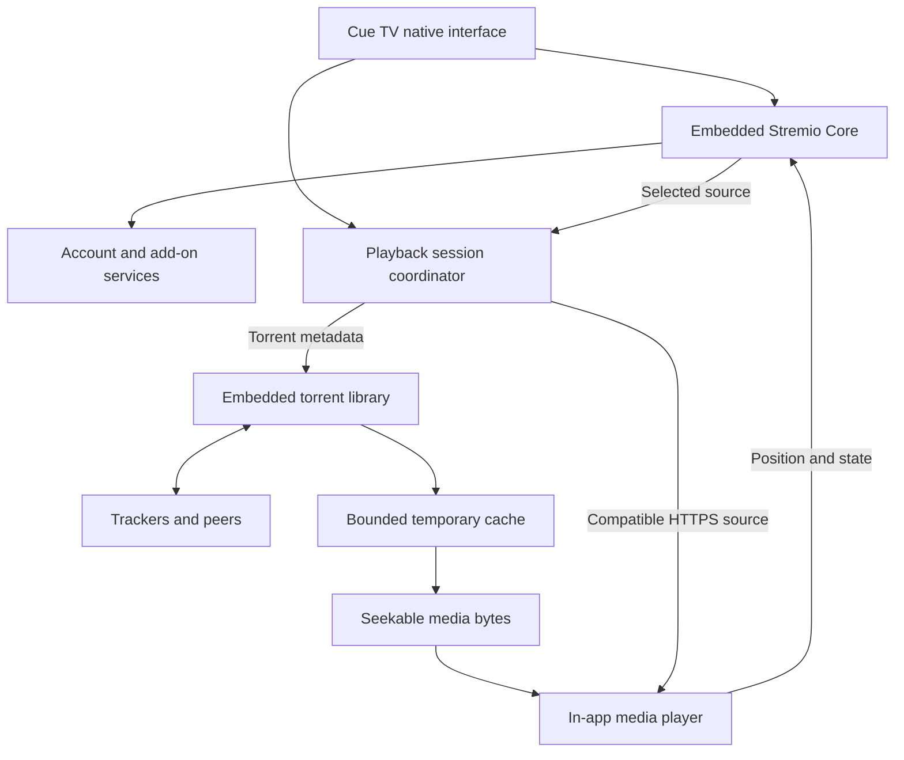

# Cue TV standalone tvOS — feasibility research

17 November 2026 · Companion to [PRD v0.1](PRD.md)

## Finding

An embedded design is technically credible, but the complete direct-torrent path has not been validated on the user’s hardware. Reuse Stremio Core for application logic; select and verify a separate torrent engine and player. Do not treat the existence of the official Stremio IPA as proof that its complete streaming implementation is reusable source code.

This investigation read upstream documentation and implementation code. It downloaded a public StremioX checkout for inspection but did not run that project’s scripts, install its vendor binaries, contact torrent peers or alter Cue TV’s implementation. The existing Cue TV build and five tests from the previous task remain the only local execution evidence.

## 1. What is established

| Finding | Evidence and confidence |
|---|---|
| Cue TV currently depends on an Android API. | Direct inspection of `TVService.swift` and `WatchModel.swift`: pairing, catalogue/library/search, event stream and playback-link requests. High confidence for the inspected snapshot. |
| Its selected-source path is not a torrent engine. | Android `StremioPlayback.kt` filters installed add-ons and responses for Torrentio/Real-Debrid sources; `StremioPlaybackData.kt` constructs external-player URLs. High confidence. |
| Core is intended to be embedded. | Current `development` documentation describes a platform `Env` plus reusable state models. Its license file is MIT. High confidence. [Core architecture](https://github.com/Stremio/stremio-core/tree/development), [license](https://github.com/Stremio/stremio-core/blob/development/LICENSE.md) |
| Core’s `StreamingServer` name does not imply an embedded torrent implementation. | Pinned implementation requests settings, statistics and other resources through `E::fetch` at a configured URL. It models and controls a service. High confidence. [Source](https://github.com/Stremio/stremio-core/blob/2c89236b47dfcd5e844c1dfae5737164cb616fbf/src/models/streaming_server.rs) |
| Native tvOS Core integration exists as public source. | StremioX has a Rust static library, C-compatible callbacks/actions/state, Swift consumers and XCFramework build script. Code inspected, not built here. [Bridge](https://github.com/yvdjee/stremiox/blob/341c87520f8c011b6a995557a1008bb6e123314b/core/src/lib.rs) |
| A fully featured official tvOS IPA has been announced. | Official Stremio publication. Upstream product claim, not a test on this Apple TV. [Announcement](https://blog.stremio.com/stremio-fully-featured-sideloadable-ipa-release-for-ios-ipados-apple-tv-tvos/) |

Earlier discussion consulted Core’s old `master` README. This investigation used the active `development` branch and inspected its actual streaming-server model. The architectural conclusion remains the same, but implementation planning must pin the current interface rather than the older module layout.

## 2. The promising reference and its catch

StremioX’s design is a useful existence example: Swift UI, a Core bridge, an in-process streaming runtime and libmpv. Its dependency script downloads a custom tvOS NodeMobile framework and obtains Stremio `server.js` separately. Its third-party notice calls that server proprietary. That notice is the maintainer’s attribution, not an independently established reuse grant from Stremio. No explicit permission to incorporate that server into Cue TV was established here. [Dependency fetch script](https://github.com/yvdjee/stremiox/blob/341c87520f8c011b6a995557a1008bb6e123314b/scripts/fetch-server-deps.sh), [notices](https://github.com/yvdjee/stremiox/blob/341c87520f8c011b6a995557a1008bb6e123314b/THIRD-PARTY-NOTICES.md)

The runtime wrapper documents restart limits, disabled external-process features and networking failures in that implementation. These make it a useful risk checklist, not a drop-in production foundation. Its comments about UDP must not be generalized into a platform-wide prohibition. [Runtime wrapper](https://github.com/yvdjee/stremiox/blob/341c87520f8c011b6a995557a1008bb6e123314b/app/Sources/NodeServer.swift)

StremioX is GPL-3.0 and uses MPVKit-GPL. Reusing its implementation code requires preserving its licensing context; conceptual reference and independent implementation are different choices. No code from it has been copied into Cue TV. [Project license](https://github.com/yvdjee/stremiox/blob/341c87520f8c011b6a995557a1008bb6e123314b/LICENSE)

**Recommendation:** study its interface boundaries, but keep the initial proposal independent of its downloaded server/runtime. The official Apple app’s exact engine and its source/reuse availability remain unresolved; claiming that the entire official application is an embeddable open-source SDK would be unsupported.

## 3. Component assessment

| Candidate | Verified from source/documentation | Unresolved for Cue TV | Recommendation |
|---|---|---|---|
| Stremio Core | Platform abstraction, accounts/add-ons/library/player state, native Rust library; MIT license file. | Exact pinned API, concurrency/lifetime rules, storage integration and account flow on our app. | Preferred application core. |
| librqbit | Embeddable Rust library; streaming prioritizes reads and supports seekable HTTP range responses; manifest declares Apache-2.0. | tvOS compilation, optional platform dependencies, peer networking, cancel semantics and bounded piece storage. | First feasibility candidate because it can share the Rust toolchain. |
| libtorrent | C++ torrent engine with explicit streaming piece deadlines; principal license is BSD-style with additional notices. | tvOS build recipe, Swift/C++ boundary, byte-serving adapter and custom cache policy. | Strong alternative; compare evidence, not languages alone. |
| VLCKit | VideoLAN’s media framework supports tvOS. | Exact build/version, hardware decode, subtitle behavior and formats on target hardware. | Player candidate. |
| MPVKit | tvOS build tooling and LGPL/GPL variants documented. | Its README cautions about production maintenance and patched Metal support; actual selected build must be evaluated. | Player candidate, not automatically preferred because the reference app uses it. |
| AVPlayer | Native platform player suitable for a constrained reference flow. | Does not establish the desired broader container/codec matrix by itself. | Useful early integration check; no claim of universal torrent-media compatibility. |

Sources: [rqbit streaming](https://github.com/ikatson/rqbit#streaming-support), [librqbit manifest](https://github.com/ikatson/rqbit/blob/f23bacdddcc5318caa813418b8eb1b1d7307faaa/crates/librqbit/Cargo.toml), [libtorrent streaming algorithm](https://www.libtorrent.org/streaming.html), [libtorrent license file](https://github.com/arvidn/libtorrent/blob/RC_2_0/LICENSE), [VLCKit](https://github.com/videolan/vlckit/blob/master/README.md), [MPVKit](https://github.com/mpvkit/MPVKit/blob/d9194243bdc68b87d8989376ab52aee7da6c8e0b/README.md).

License labels above describe the inspected files, not an audit of a final combined binary. Record exact versions, enabled features, third-party notices and distribution obligations once the dependency set is selected. The libtorrent metadata snapshot is RC_2_1 while the inspected license reference is RC_2_0; no release or license audit has been approved on that basis.

SwiftyTorrent is another older public iOS/tvOS/libtorrent integration example, but it is not evidence of a maintained, ready-to-ship solution for this device. [Project](https://github.com/danylokos/SwiftyTorrent)

## 4. Platform constraints that change the design

**Native Rust is a plausible build route.** Current Rust documentation lists ARM64 tvOS device and simulator targets as tier 2 without host tools, installable through rustup. StremioX’s older script describes them as tier 3 and uses nightly/build-std. That script is not authoritative for today’s toolchain. Select a tested Rust version and pin it; do not inherit nightly solely from the reference project. [Rust tvOS targets](https://doc.rust-lang.org/rustc/platform-support/apple-tvos.html)

**Keep playback and transfer together.** Apple normally suspends background applications. Designing Cue TV as a local torrent server for another foreground player would introduce a lifetime dependency we should avoid. This v1 stays in one process and does not promise background downloading or always-on remote control. [Apple background execution](https://developer.apple.com/documentation/xcode/configuring-background-execution-modes)

**Treat large local files as temporary.** Apple describes tvOS storage primarily as a cache and does not promise persistent large-file storage. Bound media usage, detect low space and tolerate cache reclamation. Preserve/reconstruct account and watched state separately. This project must not silently become a permanent download manager. [Apple storage explanation](https://developer.apple.com/videos/play/wwdc2023/10256/)

**An add-on is not a player.** A stream response may identify a direct video URL or a torrent info hash/file index. The implementation must route these correctly and must not mislabel a debrid HTTPS test as proof of native torrent streaming. [Stremio stream objects](https://github.com/Stremio/stremio-addon-sdk/blob/master/docs/api/responses/stream.md)

**Build success is insufficient.** Runtime peer protocols, decoder capability, memory pressure and seeking require a physical Apple TV. The user reports an Apple TV 4K A2737, 64 GB, running tvOS 27.2 (17 November 2026). Apple identifies this as the third-generation Wi-Fi model, so release networking tests must cover Wi-Fi. OS/build and Xcode compatibility remain to be verified during device pairing. Total capacity does not establish the available media-cache budget. [Apple identification](https://support.apple.com/en-us/101605) Simulator results can support UI and contract tests but cannot settle release playback claims.

## 5. Proposed integration boundaries

This diagram is a proposed design. A small loopback HTTP range adapter is one way to supply bytes to the player; a custom player I/O bridge is another. We should choose based on cancellation, seeking, buffering and complexity tests. There is no requirement to reproduce Stremio’s entire streaming-server HTTP API. If Core’s server-specific models are used, scope the adapter deliberately rather than return fabricated healthy server state.

Proposed boundaries: platform environment and state bridge; add-on/source translation; torrent session; bounded storage; media player; progress synchronization. Cue TV’s Android connection implementation can be replaced behind its view-facing interfaces. Android device discovery, companion-control sessions and home-launcher logic are not needed for this product scope.

## 6. Feasibility tests required before detailed estimates

| Question | Smallest decisive experiment | Decision if it fails |
|---|---|---|
| Can Core run natively? | Pinned source-built tvOS framework; dispatch an action, perform a fixture fetch, receive state and restart with saved state. | Repair the bridge/toolchain or choose a supported revision before UI integration. |
| Can the torrent library run on device? | Compile/link a minimal app; acquire a permitted torrent through trackers and DHT in separately instrumented cases. | Identify platform-specific dependencies; evaluate the alternative engine. Do not replace direct torrents with debrid without a product decision. |
| Does it stream rather than fully download? | Play a reference video before completion, then seek to an uncached position and cancel while blocked. | Fix piece/read prioritization or reject the engine. |
| Can storage remain bounded? | Use a media file larger than the cache allowance; exercise eviction or explicit preflight rejection and low-space recovery. | Choose a custom storage strategy or narrow accepted file sizes explicitly. |
| Can the player handle the agreed media? | Compare selected players with the same MP4/MKV, audio and subtitle fixtures on the device. | Adjust implementation or seek agreement on the supported matrix. |
| Is the system standalone? | End-to-end session with no Pi/Android/Mac service and no external player. | Trace and remove hidden runtime dependencies. |

These are implementation-plan inputs, not experiments claimed complete by this research. The current confidence level is **credible architecture with unresolved embedded-engine and physical-playback risks**.

## 7. Evidence provenance and next document

StremioX checkout inspected: `341c87520f8c011b6a995557a1008bb6e123314b`. Other upstream branch heads are recorded in [upstream-revisions.json](upstream-revisions.json); these are research snapshots, not dependency selections. Current branch documentation may change, so source pins should be used for implementation decisions. Cue TV’s extracted source provenance remains in [its manifest](SOURCE-MANIFEST.json).

Unresolved: the official Apple streaming engine’s source availability; successful tvOS builds of our selected engine/player combination; device pairing, toolchain compatibility and signing details; exact cache and media budgets. No conclusion here requires installing the StremioX proprietary server.

Once the PRD defaults are reviewed, the implementation plan should turn its requirement IDs and gates into stages with concrete tasks, interface contracts, failure paths, acceptance tests, dependency versions, deliverables and rollback steps. The first stage must retire the engine/player feasibility risks before estimates for the full user experience are treated as reliable.
